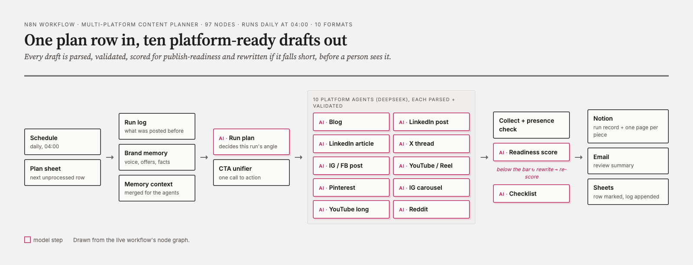

# Multi-Platform Content Planner (n8n)

An n8n workflow that turns one row of a content plan into ten platform-ready drafts every morning, checks them, scores them for publish-readiness, rewrites the weak ones and sends an editor a review brief. Nothing is published automatically: a person approves every piece.



## What one run does

1. **Picks the next plan row** (`Status` blank, `READY` or `PENDING`) from the **Plan** sheet.
2. **Builds context**: brand memory (voice, audience, offer, banned phrases) plus the last 30 runs from the **Log**, so hooks and openers aren't repeated.
3. **Run Plan agent** sets one angle, core message, proof points and call to action for the day. A CTA unifier makes every platform use the same one.
4. **Ten platform agents** (DeepSeek, in parallel), each with a structured output parser and a validator:
   Blog · LinkedIn post · LinkedIn article · X thread · Instagram/Facebook post · Instagram carousel · Reel/Short script · YouTube long-form · Pinterest pin · Reddit post.
5. **Quality gate**: a presence check, then a **publish-readiness score**. Anything below the bar is **rewritten and re-scored**.
6. **Checklist agent** writes the day's execution checklist with time estimates.
7. **Delivery**: a Notion page per piece plus a run record, an email brief to the editor, the plan row marked done and the run logged.

Runs daily at 04:00 (Schedule Trigger), or on demand with **Execute workflow**.

## Set it up

### 1. Google Sheet
Create one spreadsheet with four tabs and import the matching CSV from [`seed/`](seed/) into each (*File → Import → Upload → Replace current sheet*):

| Tab name | Seed file | What it holds |
|---|---|---|
| `Plan` | `plan.csv` | One row per day: topic, pillar, CTA keyword, status |
| `Brand_Memory` | `brand_memory.csv` | Key/Value pairs: brand name, handle, voice, audience, offer, banned phrases |
| `Log` | `log.csv` | Header only; the workflow appends every run |
| `Notion Log` | `notion_log.csv` | Header only; one row per generated piece |

The seed data is a fictional company, **Brightline Analytics**. Replace the Brand_Memory values and plan rows with your own; every agent reads the brand from Brand_Memory, so no prompt needs editing.

### 2. Import the workflow
In n8n: **Workflows → Import from file** → [`workflows/multi-platform-content-planner.json`](workflows/multi-platform-content-planner.json).

### 3. Connect credentials and IDs
| Where | Set |
|---|---|
| Every Google Sheets node | your Google Sheets credential, and replace `YOUR_GOOGLE_SHEET_ID` with the spreadsheet ID from its URL |
| Every `… DeepSeek Chat Model` node | your DeepSeek credential (or swap in any chat-model node) |
| Both Notion nodes | your Notion credential, and replace `YOUR_NOTION_DATABASE_ID` with your content database |
| Send Email | your SMTP credential, and the from/to addresses |

### 4. Test, then activate
Set one plan row's `Status` to `READY`, click **Execute workflow**, and check that all ten branches reach **Merge**. Then activate it for the daily run.

## Costs and limits

- One run makes roughly 15–20 model calls (ten agents, run plan, score, an optional rewrite and re-score, checklist). With DeepSeek that is a few cents a day.
- **Merge** waits for all ten branches, so one failing agent stops the run before anything is half-delivered. Check the execution log for the node in red.
- Video scripts come in English and Hindi. Repurpose the `_hi` fields for any second language, or drop them from the validators.

## Files

```
workflows/multi-platform-content-planner.json   the n8n workflow (97 nodes)
seed/plan.csv                                   7 example plan days
seed/brand_memory.csv                           example brand memory (Key/Value)
seed/log.csv, seed/notion_log.csv               sheet headers the workflow writes to
docs/workflow.png                               structure diagram
```

---

Built by [CodeITronics](https://codeitronics.com). We design and run content and automation systems like this for teams.
